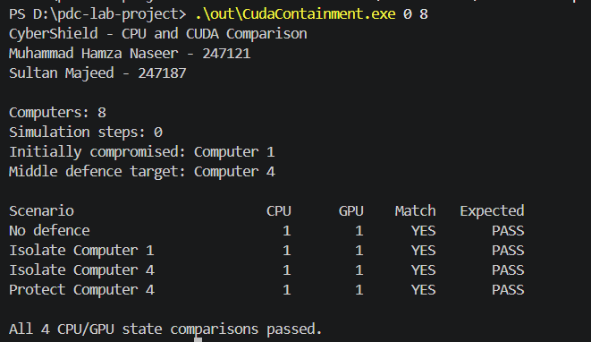
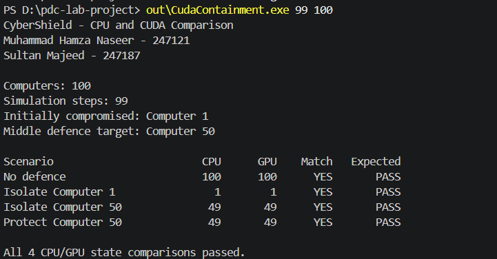
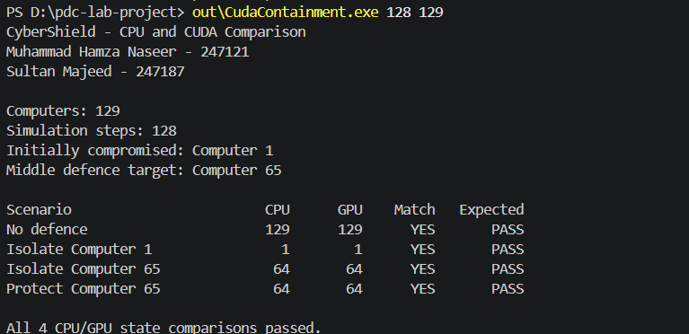
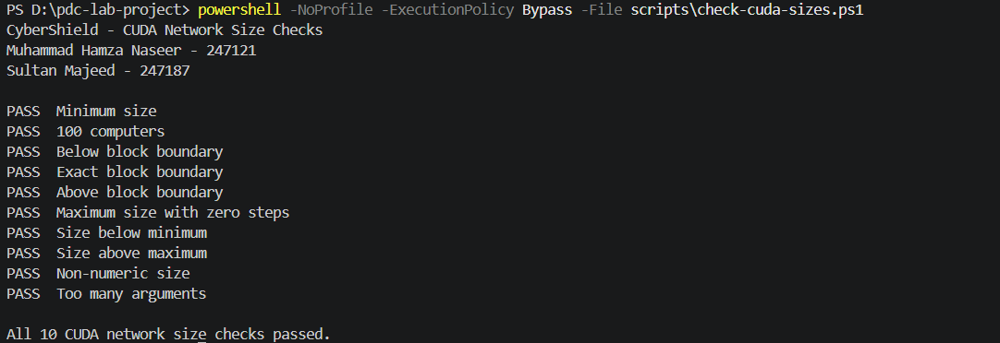

# CUDA Configuration and Boundary Checks

## Project Members

- Muhammad Hamza Naseer — 247121
- Sultan Majeed — 247187

## Work Completed By

Muhammad Hamza Naseer — configurable CUDA execution and automated checks.

## Command-Line Options

```bat
out\CudaContainment.exe [steps] [computers]
```

| Argument | Default | Accepted range |
|---|---:|---:|
| Steps | 7 | 0–10000 |
| Computers | 8 | 3–10000 |

Arguments are optional and positional. The first argument is always
the step count. To specify a network size, provide both arguments.

Only decimal digits are accepted. Invalid values and excess arguments
produce an error and a nonzero exit code.

Examples:

```bat
out\CudaContainment.exe
out\CudaContainment.exe 0
out\CudaContainment.exe 99 100
out\CudaContainment.exe 128 129
```

## Scenario Rules

Every run compares four scenarios:

1. No defence.
2. Isolate Computer 1.
3. Isolate the middle computer.
4. Protect the middle computer.

Computer 1 starts compromised in every scenario.

The CUDA program selects the middle defence target using integer
division: `(computers + 1) / 2`.

For even-sized chains, this selects the lower middle computer.
For 100 computers, the target is Computer 50.

The existing Java chain factory uses `size / 2 + 1`, which selects
Computer 51 for a size of 100. These targets must be aligned before
direct Java/CUDA scenario comparisons.

## Correctness Verification

The program compares every computer's CPU and GPU state.

Both state arrays are also checked against expected states calculated
from chain distance and defence positions.

With zero steps, the initial state must remain unchanged.

| Steps | Computers | No defence | Isolate source | Isolate middle | Protect middle |
|---:|---:|---:|---:|---:|---:|
| 0 | 8 | 1 | 1 | 1 | 1 |
| 99 | 100 | 100 | 1 | 49 | 49 |
| 128 | 129 | 129 | 1 | 64 | 64 |

## Screenshot Evidence

### Zero Steps



Figure 1: Only Computer 1 remains compromised in all four scenarios
when no propagation steps are executed.

### Configurable Network Size



Figure 2: A 100-computer chain is simulated for 99 steps.
CPU and GPU states match the expected results.

### Multiple GPU Blocks



Figure 3: With 128 threads per block, 129 computers require two blocks.
Threads with indices outside the network return without accessing arrays.

## Automated Checks

Run the step-count checks:

```bat
powershell -NoProfile -ExecutionPolicy Bypass -File scripts\check-cuda-steps.ps1
```

Run the network-size checks:

```bat
powershell -NoProfile -ExecutionPolicy Bypass -File scripts\check-cuda-sizes.ps1
```

The size checks cover:

- Minimum accepted network size.
- A 100-computer chain.
- Sizes 127, 128 and 129 around the GPU block boundary.
- Maximum accepted size with zero simulation steps.
- Sizes below and above the accepted range.
- Non-numeric size input.
- Excess command-line arguments.

The scripts run the existing executable. Rebuild after source changes.



Figure 4: Automated network-size checks report their individual results.

## Build Script

```bat
scripts\build-cuda.cmd
```

This script initializes the C++ environment, builds the CPU reference
checks and CUDA program, and runs the CPU and step-count checks.

Network-size checks currently run separately.

## Limitations

These checks verify correctness and input handling.
They do not measure GPU speedup.

The maximum-size check uses zero steps; it does not establish performance
or propagation correctness at the maximum size.

See [CUDA containment](cuda-containment.md) for the implementation
overview and earlier execution evidence. This page describes the newer
configuration options that replace the earlier fixed-size and fixed-step
limitations.