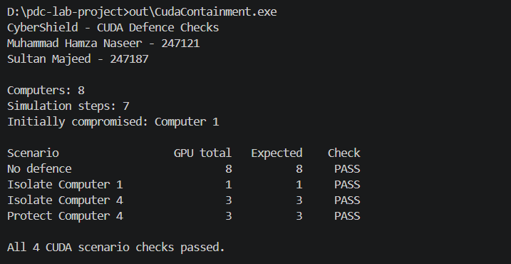

# CUDA Chain Containment Simulation

## Project Members

- Muhammad Hamza Naseer — 247121
- Sultan Majeed — 247187

## Implementation By

Muhammad Hamza Naseer — CUDA propagation, isolation, protection,
and scenario verification.

## Simulation Setup

- Eight computers connected in a chain.
- Computer 1 starts compromised.
- Each scenario runs for seven simulation steps.
- Each scenario starts with fresh states and GPU allocations.

## Propagation Rules

A healthy computer becomes compromised when an immediate neighbour
was compromised at the beginning of the step, provided that:

- The receiving computer is not isolated.
- The receiving computer is not protected.
- The sending computer is not isolated.

Existing compromises persist. There is no recovery.

## Isolation and Protection

Isolation prevents a computer from sending or receiving an attack.

Protection prevents a healthy computer from becoming compromised.
Protection does not cure an existing compromise or stop an already
compromised computer from sending an attack.

## GPU Execution

Each GPU thread calculates the next state of one computer.

The kernel reads current states and writes to a separate next-state
array. This prevents a newly compromised computer from spreading
the attack again during the same step.

After each kernel completes, the array pointers are swapped.

Isolation and protection flags remain unchanged during each scenario.

## Scenario Checks

| Scenario | Expected compromised computers | Expected total |
|---|---|---:|
| No defence | 1–8 | 8 |
| Isolate Computer 1 | 1 | 1 |
| Isolate Computer 4 | 1–3 | 3 |
| Protect Computer 4 | 1–3 | 3 |

The program checks every computer's final state against a manually
specified expected state. Matching totals alone are not sufficient.

A mismatch prints the scenario, computer ID, expected state and
actual state. The program returns a nonzero exit code on failure.

CUDA API calls and kernel execution are also checked for errors.

## Build and Run

Initialize the C++ build environment in CMD:

```bat
call "C:\Program Files\Microsoft Visual Studio\18\Community\VC\Auxiliary\Build\vcvarsall.bat" x64 -vcvars_ver=14.44
cd /d D:\pdc-lab-project
```

Compile:

```bat
nvcc cuda\CudaContainment.cu -o out\CudaContainment.exe
```

Run after successful compilation:

```bat
out\CudaContainment.exe
```

Successful verification ends with:

```text
All 4 CUDA scenario checks passed.
```

## Execution Evidence



Figure 1: All four scenarios pass verification of every computer's
final state on the GPU.

## Earlier Propagation Milestone


Figure 2: Earlier verification of seven-step propagation without defence.

## Current Limitations

- Network size, step count and scenarios are fixed.
- Only chain topology is implemented.
- No sequential CPU reference is executed by this CUDA program yet.
- Performance and GPU speedup have not been measured.
- Protection of an already compromised source has not yet been
  covered by a dedicated scenario check.