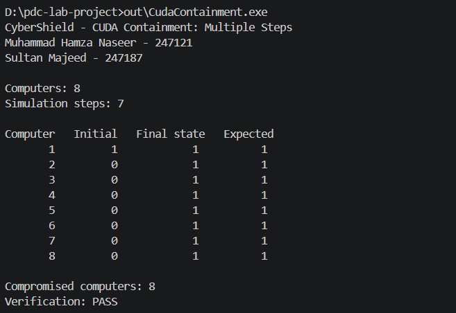

# CUDA Chain Containment Simulation

## Project Members

- Muhammad Hamza Naseer — 247121
- Sultan Majeed — 247187

## Implementation By

Muhammad Hamza Naseer — CUDA propagation implementation.

## Current Scenario

- Topology: chain of eight computers.
- Initially compromised: Computer 1.
- Simulation steps: seven.
- Defence: none.
- Expected final compromised count: eight.

## Parallel Execution

Each GPU thread calculates the next state of one computer.
A healthy computer becomes compromised if an immediate neighbour
was compromised at the beginning of the step.

The kernel reads from a current-state array and writes to a
separate next-state array. This prevents the attack from spreading
more than one connection per step.

After each kernel completes, the two array pointers are swapped.
Existing compromises persist.

## Build and Run

Use a CMD terminal with the C++ build environment initialized:

```bat
nvcc cuda\CudaContainment.cu -o out\CudaContainment.exe
out\CudaContainment.exe
```

## Verification

The program checks every computer's final state against the
expected state and returns a nonzero exit code if verification fails.

Expected final output:

```text
Compromised computers: 8
Verification: PASS
```



Figure 1: Seven propagation steps reach all eight computers in the chain.

## Current Limitations

This version uses a fixed chain and has no isolation or protection.
It does not yet measure performance or compare against a CPU simulation.