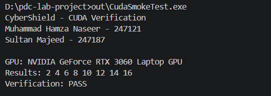

# CUDA Setup and Verification

## Project Members

- Muhammad Hamza Naseer — 247121
- Sultan Majeed — 247187

## Work Completed By

Muhammad Hamza Naseer — CUDA environment setup and verification.

## Verified Environment

- GPU: NVIDIA GeForce RTX 3060 Laptop GPU
- CUDA Toolkit: 12.8, compiler V12.8.93
- Visual Studio: Community 2026
- MSVC toolset: 14.44.35207
- Build target: x64

## Setup Issue and Resolution

Initially, CUDA compilation failed with:
`Host compiler targets unsupported OS.`

The C++ compiler existed, but `vcvarsall.bat` was missing.
After installing the Desktop development with C++ workload,
the script became available and compilation succeeded.

## Build and Run

Run in Command Prompt:

```bat
call "C:\Program Files\Microsoft Visual Studio\18\Community\VC\Auxiliary\Build\vcvarsall.bat" x64 -vcvars_ver=14.44
cd /d D:\pdc-lab-project
nvcc cuda\CudaSmokeTest.cu -o out\CudaSmokeTest.exe
out\CudaSmokeTest.exe
```

## Verification

The program copies eight integers from CPU memory to GPU memory.
A CUDA kernel doubles each value. The results are copied back
and checked against the expected values.

Observed results:

```text
GPU: NVIDIA GeForce RTX 3060 Laptop GPU
Results: 2 4 6 8 10 12 14 16
Verification: PASS
```

Compilation also displayed a deprecated GPU target warning.
It did not prevent compilation or successful execution.

This test verifies GPU execution and memory transfers.
It does not yet implement containment simulation or measure speedup.

## Execution Screenshot



Figure 1: The GPU doubles all eight input values and passes verification.