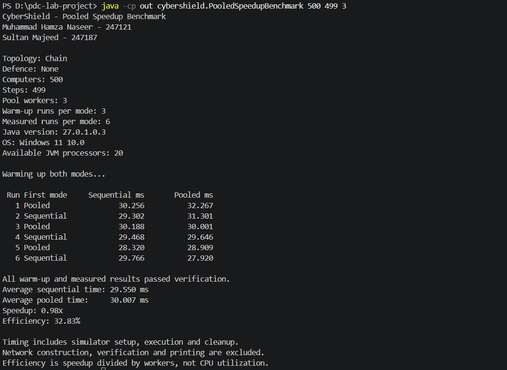

# Sequential versus Pooled Speedup Benchmark

## Project Members

- Muhammad Hamza Naseer — 247121
- Sultan Majeed — 247187

## Work Completed By

Muhammad Hamza Naseer — benchmark implementation and execution.

## Purpose

Compare target-first sequential execution with pooled data-parallel
execution using the same target-search condition and early-exit rule.

This differs from ThreadReuseBenchmark, which compares two parallel
implementations.

## Configuration

| Setting | Value |
|---|---|
| Topology | Chain |
| Defence | None |
| Initially compromised | Computer 1 |
| Computers | 500 |
| Simulation steps | 499 |
| Pool workers | 3 |
| Warm-up runs per mode | 3 |
| Measured runs per mode | 6 |

## Reported Execution Environment

| Property | Reported value |
|---|---|
| Java version | 27.0.1.0.3 |
| Operating system | Windows 11 |
| OS version reported by Java | 10.0 |
| Processors available to the JVM | 20 |

The JVM processor count does not establish the number of physical cores.

CPU model, power mode, charger state, thermal conditions and background
activity were not captured in this result record.

Earlier measurements from another laptop must not be attributed to
this environment.

## Timing Method

Each execution receives a freshly constructed chain network.

Included in timing:

- Simulator setup.
- All simulation steps.
- Pool thread creation and task coordination in pooled mode.
- Worker cleanup and pool closure.

Excluded from timing:

- Network construction.
- Result verification.
- Console printing.

Measurements use System.nanoTime.

Three warm-up runs per mode precede six measured runs.
The first execution mode alternates between measured rounds.

Each pooled run creates a new pool and reuses it across its 499 steps.

## Correctness Verification

Every warm-up and measured execution is checked against the expected
final states of an unprotected chain starting at Computer 1.

The checks verify:

- All 500 computers finish compromised.
- Exactly 499 new compromises accumulate.
- Computer IDs are correct.
- Isolation and protection flags remain false.

All warm-up and measured results passed verification.

## Recorded Results

| Run | First mode | Sequential (ms) | Pooled (ms) |
|---:|---|---:|---:|
| 1 | Pooled | 30.256 | 32.267 |
| 2 | Sequential | 29.302 | 31.301 |
| 3 | Pooled | 30.188 | 30.001 |
| 4 | Sequential | 29.468 | 29.646 |
| 5 | Pooled | 28.320 | 28.909 |
| 6 | Sequential | 29.766 | 27.920 |

| Metric | Reported result |
|---|---:|
| Mean sequential time | 29.550 ms |
| Mean pooled time | 30.007 ms |
| Speedup | 0.98x |
| Efficiency | 32.83% |
| Approximate pooled elapsed-time increase | 1.55% |

Means and ratios are calculated from internal nanosecond measurements.
Printed values are rounded.

## Calculations

Speedup:

```text
mean sequential time / mean pooled time
```

Efficiency:

```text
speedup / worker count × 100%
```

Efficiency describes speedup relative to the configured worker count.
It is not a measurement of CPU utilization.

## Interpretation

Pooled execution was approximately 1.55% slower on average in this session.

It was faster than sequential execution in two of the six measured rounds,
but did not produce an overall speedup.

Task submission, coordination, pool lifecycle costs and unequal work
per target range are possible contributors. These costs were not
measured separately, so the result does not establish their individual
effects.

Contiguous ranges contain similar numbers of computers but may require
different amounts of source searching.

This result does not contradict the earlier thread-reuse benchmark.
A pool can outperform repeated thread creation while still failing
to outperform sequential execution.

## Compile and Run

```powershell
javac -d out src\cybershield\*.java
```

After successful compilation:

```powershell
java -cp out cybershield.PooledSpeedupBenchmark 500 499 3
```

The same configuration is used when no arguments are supplied.

When arguments are supplied, all three are required:

```text
PooledSpeedupBenchmark [computers steps workers]
```

Accepted ranges:

- Computers: 3–1000.
- Steps: 1–1000.
- Workers: 1–min(computers, 16).

## Limitations

- These measurements come from one benchmark session.
- Only one topology, scenario, size and worker count are recorded here.
- Three warm-up runs do not guarantee complete JVM warm-up.
- The observed average difference is small and may vary across sessions.
- No statistical confidence interval was calculated.
- Pool setup and shutdown are included; steady-state pool reuse across
  multiple simulations is not measured.
- The benchmark checks final states and accumulated new compromises,
  rather than retaining every intermediate state.
- Larger workloads or other worker counts may behave differently.
## Execution Screenshot



Figure 1: For 500 computers, 499 steps and three workers, mean sequential
time is 29.550 ms and mean pooled time is 30.007 ms. Reported speedup
is 0.98x and efficiency is 32.83%. All verification checks pass.
