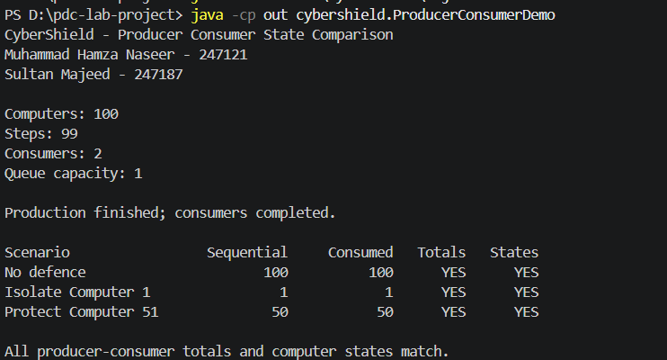

# Producer-Consumer State Comparison

## Project Members

- Muhammad Hamza Naseer — 247121
- Sultan Majeed — 247187

## Work Completed By

Muhammad Hamza Naseer — producer-consumer state verification.

## Purpose

ProducerConsumerDemo verifies that tasks passed through a bounded
blocking queue produce the same final results as sequential execution.

It compares individual computer states as well as compromised totals.

## Configuration

| Setting | Value |
|---|---:|
| Computers per scenario | 100 |
| Simulation steps | 99 |
| Consumer threads | 2 |
| Queue capacity | 1 |

Computer 1 starts compromised in every scenario.
Each scenario owns a separate chain network.

## Producer and Consumers

The main thread acts as the producer.

It creates the scenario tasks and adds them to BlockingTaskQueue.
If the queue is full, put waits until space is available or the
queue is closed.

Consumers start before production begins.
Each consumer retrieves a task, executes it, then requests another.

If the queue is empty and still open, take waits for more work.

Task execution occurs outside the queue lock, allowing independent
scenarios to run concurrently.

## Synchronization

The queue uses synchronized methods, wait and notifyAll.

The producer and consumers check waiting conditions in while loops.

Queue capacity limits waiting tasks, not tasks already being executed
by consumers.

## Normal Shutdown

The producer closes the queue after production finishes.

Consumers continue retrieving remaining queued tasks.
When the closed queue is empty, take returns null and consumers exit.

The main thread joins the consumers before reading results.

## Failure Handling

An uncaught consumer failure is recorded in that consumer's failure
slot. Its handler also closes the queue to wake a producer that may
be waiting for space.

If production completes normally, the main thread checks consumer
failure slots after joining and reports failures with their causes.

If production fails, the finally block closes the queue and attempts
to join consumers before the producer exception propagates.

Failed tasks are not retried.

ConsumerWorker handles InterruptedException by restoring its interrupt
flag and exiting. Interruptions are not recorded by the uncaught
exception handler. This demo does not deliberately interrupt consumers.

## Result Verification

Each consumed scenario is compared against a fresh sequential execution.

The program compares:

- Final compromised total.
- Each computer's ID.
- Compromised state.
- Isolation flag.
- Protection flag.

State mismatches print the scenario, computer ID and both computer
representations.

After comparing all scenarios, any mismatch causes an AssertionError.

## Compile and Run

From the project directory:

```powershell
javac -d out src\cybershield\*.java
```

After successful compilation:

```powershell
java -cp out cybershield.ProducerConsumerDemo
```

## Expected Successful Results

| Scenario | Sequential | Consumed | Totals | States |
|---|---:|---:|---|---|
| No defence | 100 | 100 | YES | YES |
| Isolate Computer 1 | 1 | 1 | YES | YES |
| Protect Computer 51 | 50 | 50 | YES | YES |

Successful execution ends with:

```text
All producer-consumer totals and computer states match.
```

## Connection to the Course

This demonstrates the producer-consumer pattern, bounded buffering,
Java threads, synchronization, wait/notifyAll and task parallelism.

Each scenario still processes its own network sequentially.
Parallel execution occurs across independent scenarios.

## Limitations

The program compares final states rather than every intermediate step.

Matching this execution does not prove correctness for every possible
input or thread schedule.

The demo does not measure speedup, guarantee equal work distribution,
or provide complete cancellation and failure recovery.
## Execution Screenshot



Figure 1: Two consumers process three scenarios through a queue with
capacity one. Final totals and individual computer states match
fresh sequential executions.
