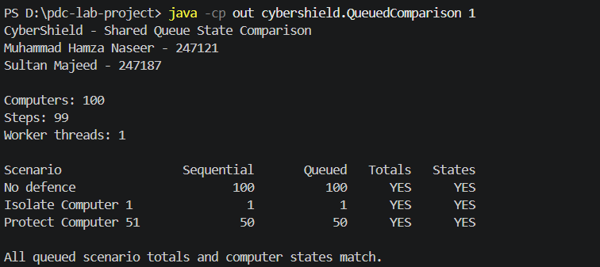
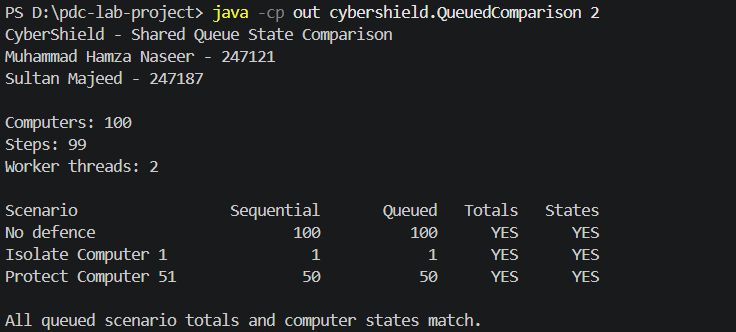
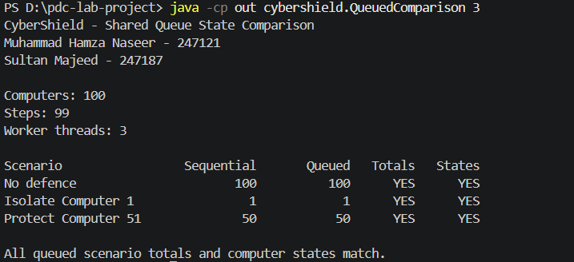

# Shared Queue State Comparison

## Project Members

- Muhammad Hamza Naseer — 247121
- Sultan Majeed — 247187

## Work Completed By

Muhammad Hamza Naseer — shared-queue result verification.

## Purpose

QueuedComparison compares sequential execution with worker threads
that obtain simulation tasks from a shared queue.

It checks both compromised totals and individual computer states.
Equal totals alone could hide differences in which computers were
compromised.

## Simulation Setup

- Topology: chain of 100 computers.
- Simulation steps: 99.
- Initially compromised: Computer 1.
- Supported worker counts: 1, 2 and 3.
- Default worker count: 2.

| Scenario | Expected compromised total |
|---|---:|
| No defence | 100 |
| Isolate Computer 1 | 1 |
| Protect Computer 51 | 50 |

## Sequential Baseline

The main thread runs three scenario tasks sequentially.

Their networks are retained so individual computer states can be
compared after queued execution.

## Shared Queue Execution

The queued run creates fresh tasks and networks.

All workers share one TaskQueue. Its synchronized poll method returns
the next available task, or null when the queue is exhausted.

A worker runs its retrieved task outside the queue lock, then polls again.

This allows independent scenario tasks to run concurrently.

Each task owns a separate network. A scenario's internal simulation
remains sequential.

## Dynamic Task Assignment

The worker that retrieves a task depends on thread scheduling and
when workers finish their previous tasks.

The number of workers does not guarantee an equal task distribution.
A worker may process multiple tasks while another processes fewer.

The queue is prefilled and finite. It does not wait for a producer
to add more tasks.

## State Verification

After every worker has completed, the program compares:

- Scenario compromised totals.
- Each computer's ID.
- Each computer's compromised state.
- Each computer's isolation flag.
- Each computer's protection flag.

A mismatch prints the scenario, computer ID and both state
representations.

The program checks all scenario results before throwing an
AssertionError if any totals or states differ.

## Completion and Worker Failures

The main thread joins all workers before reading task results,
network states or failure slots.

Each worker has a separate slot for an uncaught failure.
After joining, the main thread checks these slots and reports a worker
failure using IllegalStateException with the original cause.

The program does not retry failed tasks.

## Compile and Run

From the project directory:

```powershell
javac -d out src\cybershield\*.java
```

After successful compilation:

```powershell
java -cp out cybershield.QueuedComparison 1
java -cp out cybershield.QueuedComparison 2
java -cp out cybershield.QueuedComparison 3
```

## Expected Successful Results

Each supported worker count should produce:

| Scenario | Sequential | Queued | Totals | States |
|---|---:|---:|---|---|
| No defence | 100 | 100 | YES | YES |
| Isolate Computer 1 | 1 | 1 | YES | YES |
| Protect Computer 51 | 50 | 50 | YES | YES |

Successful execution ends with:

```text
All queued scenario totals and computer states match.
```

## Connection to the Course

This demonstrates Java threads, Runnable tasks, synchronization,
task parallelism and dynamic work assignment.

Synchronization protects queue retrieval. Independent networks avoid
sharing mutable simulation state between scenario tasks.

## Limitations

The checks compare final states, not intermediate states after each step.

Matching these runs does not prove correctness for every possible
input or thread schedule.

This program does not measure speedup, efficiency or task distribution.
## Execution Screenshots



Figure 1: One worker processes the queued scenarios. Final totals and
individual computer states match sequential execution.



Figure 2: Two workers retrieve tasks from the shared queue. All scenario
totals and individual computer states match sequential execution.



Figure 3: Three workers retrieve tasks from the shared queue. All scenario
totals and individual computer states match sequential execution.
