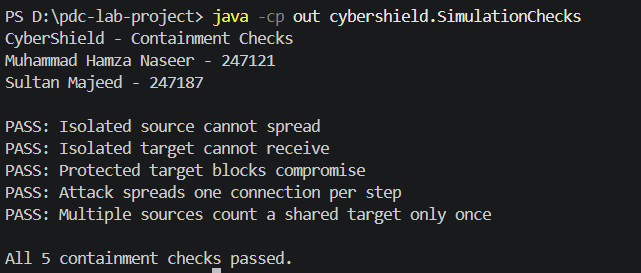

# Java Simulation Correctness Checks

## Project Members

- Muhammad Hamza Naseer — 247121
- Sultan Majeed — 247187

## Work Completed By

Muhammad Hamza Naseer — sequential simulation verification.

## Purpose

These checks verify containment rules, step-by-step propagation,
shared-target counting, and protection of an already compromised source.

Each check starts with a fresh network.

## Checks

| Check | Required behaviour |
|---|---|
| Isolated source | A compromised isolated computer cannot spread |
| Isolated target | An isolated healthy computer cannot receive |
| Protected target | A protected healthy computer cannot become compromised |
| One connection per step | Newly compromised computers spread only in the next step |
| Shared target | Multiple sources count the same newly compromised target once |
| Protected compromised source | Protection does not cure an existing compromise or stop its spread |

## Blocked-Spread Checks

The first three checks use a three-computer chain:

- Computer 1 connects to Computer 2.
- Computer 2 connects to Computer 3.
- Only Computer 1 starts compromised.

Each check applies one defence and executes two steps.

Both steps must report zero new compromises. Only Computer 1
must remain compromised.

## Step-by-Step Propagation

The fourth check uses the same chain without defence.

| Stage | Computer 1 | Computer 2 | Computer 3 | Newly compromised |
|---|---|---|---|---:|
| Initial | Compromised | Healthy | Healthy | Not applicable |
| Step 1 | Compromised | Compromised | Healthy | 1 |
| Step 2 | Compromised | Compromised | Compromised | 1 |
| Step 3 | Compromised | Compromised | Compromised | 0 |

The check verifies individual states, total compromises, and the
new-compromise count returned by each step.

## Multiple Sources and a Shared Target

The fifth check uses four computers:

- Computers 1 and 2 start compromised.
- Both connect to Computer 3.
- Computer 4 is disconnected and starts healthy.

| Stage | Compromised computers | Newly compromised |
|---|---|---:|
| Initial | 1 and 2 | Not applicable |
| Step 1 | 1, 2 and 3 | 1 |
| Step 2 | 1, 2 and 3 | 0 |

Computer 3 receives attacks from two sources but counts as only
one newly compromised computer.

Computer 4 must remain healthy in both steps.

## Protection of an Already Compromised Source

The sixth check uses the three-computer chain.

Computer 1 is compromised first, and protection is then applied to it.
It is not isolated.

The check verifies that:

- Applying protection preserves Computer 1's compromised state.
- Computer 1 remains protected and not isolated.
- Computer 2 becomes compromised in step 1.
- Computer 3 remains healthy until step 2.
- Computer 3 becomes compromised in step 2.
- Each step reports exactly one new compromise.

In this simulation, protection prevents new compromise.
It does not provide recovery or block sending from an already
compromised computer.

Isolation blocks sending and receiving. Recovery is not implemented.

These are project modelling rules, not a claim about every real-world
security product.

## Connection to the Course

The propagation check demonstrates data dependence between steps.

The simulator first records pending compromises without changing
computer states. It applies changes after checking the whole network.

The shared-target check verifies that the simulator counts distinct
newly compromised computers rather than incoming attacks.

The pending-compromise array records each target with a boolean flag.
The application phase counts each marked target once.

These checks define expected behaviour for parallel implementations.
They do not establish thread safety.

## Compile and Run

From the project directory:

```powershell
javac -d out src\cybershield\*.java
```

After successful compilation:

```powershell
java -cp out cybershield.SimulationChecks
```

## Successful Output

```text
CyberShield - Containment Checks
Muhammad Hamza Naseer - 247121
Sultan Majeed - 247187

PASS: Isolated source cannot spread
PASS: Isolated target cannot receive
PASS: Protected target blocks compromise
PASS: Attack spreads one connection per step
PASS: Multiple sources count a shared target only once
PASS: Protection does not cure a compromised source

All 6 containment checks passed.
```

A failed check explicitly throws an AssertionError and stops execution.
Java's `-ea` option is not required.

## Earlier Execution Evidence


Figure 1: The four-check version verifies containment and
one-connection-per-step propagation.



Figure 2: The five-check version adds shared-target counting verification.

These screenshots predate the sixth check.

## Scope

These checks cover small sequential Java simulations.
They do not measure performance or verify concurrent execution.