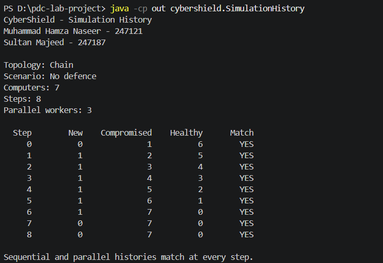
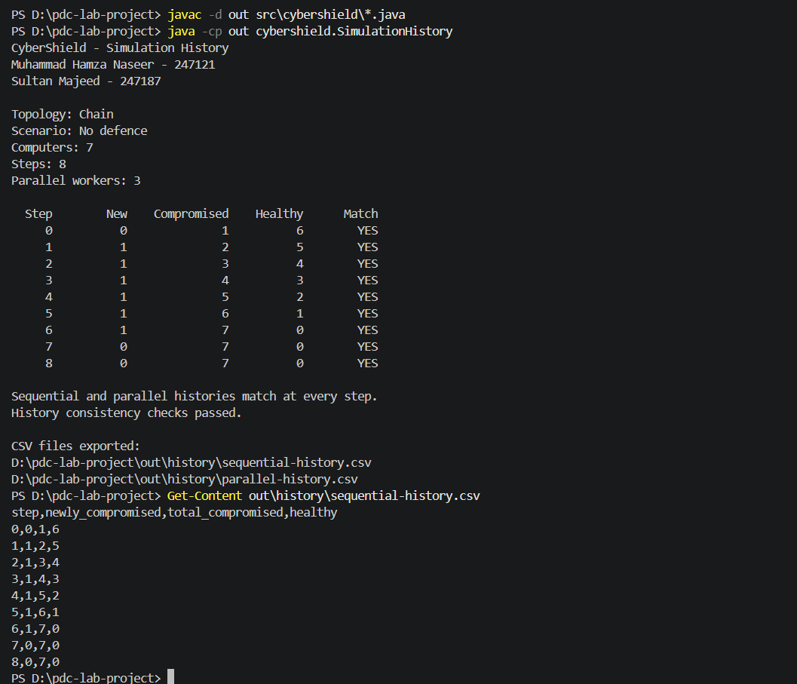
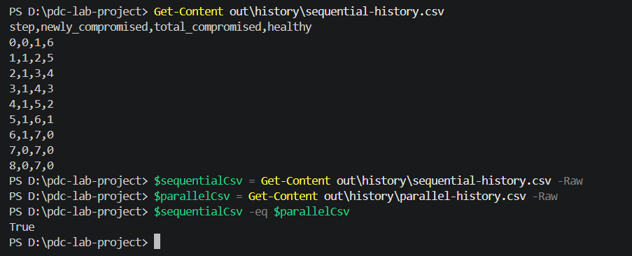

# Simulation History and CSV Export

## Project Members

- Muhammad Hamza Naseer — 247121
- Sultan Majeed — 247187

## Work Completed By

Muhammad Hamza Naseer — per-step history recording, sequential/
data-parallel verification and CSV export.

## Purpose

SimulationHistory records how a network changes after every step.

It runs separate sequential and data-parallel networks, compares their
histories and individual states, then exports the verified histories.

## Implementation Files

- `src/cybershield/SimulationHistory.java`
- `src/cybershield/HistoryCsvExporter.java`

## Current Configuration

| Setting | Value |
|---|---|
| Topology | Chain |
| Computers | 7 |
| Simulation steps | 8 |
| Initially compromised | Computer 1 |
| Defence | None |
| Data-parallel workers | 3 |

The simulation configuration is fixed.
The output directory can be supplied as a command-line argument.

## History Entries

Each HistoryEntry is an immutable Java record containing:

| Java field | CSV column | Meaning |
|---|---|---|
| step | step | Simulation step number |
| newlyCompromised | newly_compromised | New compromises during this step |
| totalCompromised | total_compromised | Total compromises after the step |
| healthy | healthy | Computers that are not compromised |

Entries contain integer values rather than mutable computer references.
Later simulation changes do not alter earlier entries.

## Initial State

Step 0 records the network before propagation.

Computer 1 is already compromised, so the total is one.
The new-compromise count is zero because no step has executed.

## Expected History

| Step | New | Compromised | Healthy |
|---|---:|---:|---:|
| 0 | 0 | 1 | 6 |
| 1 | 1 | 2 | 5 |
| 2 | 1 | 3 | 4 |
| 3 | 1 | 4 | 3 |
| 4 | 1 | 5 | 2 |
| 5 | 1 | 6 | 1 |
| 6 | 1 | 7 | 0 |
| 7 | 0 | 7 | 0 |
| 8 | 0 | 7 | 0 |

The attack advances one connection per step.
After step 6, further steps produce no new compromises.

## Correctness Checks

The program verifies:

- Matching initial individual computer states.
- Matching individual states after every step.
- Matching sequential and parallel history entries.
- One initial entry plus one entry per simulation step.
- Ordered step numbers.
- Compromised plus healthy equals the network size.
- Nonnegative new-compromise and healthy counts.
- Compromised totals never decrease.
- Each increase in the total equals that step's new-compromise count.
- Counts match the expected result for this specific chain scenario.

Both complete history lists are also compared.

A failed check throws an AssertionError.
CSV export begins only after all these checks pass.

## CSV Export Behaviour

HistoryCsvExporter writes UTF-8 files with one header row.

It creates missing parent directories and closes its writer using
try-with-resources.

The exporter rejects null destinations, null history lists and null
history entries before opening the output file.

Running the program again replaces the two existing output files.
Rows are not appended.

The files are written separately, not as one atomic operation.
If the second export fails, the first file may already have been written.

File-writing failures propagate as IOException.

## Compile and Run

From the project directory:

```powershell
javac -d out src\cybershield\*.java
```

After successful compilation:

```powershell
java -cp out cybershield.SimulationHistory
```

Default output files:

```text
out/history/sequential-history.csv
out/history/parallel-history.csv
```

The default output directory is inside the ignored out directory.

## Custom Output Directory

Provide one optional directory argument:

```powershell
java -cp out cybershield.SimulationHistory "out/history-custom"
```

Relative paths are resolved from the working directory.
Paths containing spaces should be quoted.

The output filenames remain sequential-history.csv and
parallel-history.csv.

## CSV Contents

Both files should contain:

```csv
step,newly_compromised,total_compromised,healthy
0,0,1,6
1,1,2,5
2,1,3,4
3,1,4,3
4,1,5,2
5,1,6,1
6,1,7,0
7,0,7,0
8,0,7,0
```

Each file has nine data rows plus its header.

## Inspect and Compare Exports

Display the sequential export:

```powershell
Get-Content out\history\sequential-history.csv
```

Compare complete file contents:

```powershell
$sequentialCsv = Get-Content out\history\sequential-history.csv -Raw
$parallelCsv = Get-Content out\history\parallel-history.csv -Raw
$sequentialCsv -eq $parallelCsv
```

Expected comparison result:

```text
True
```

The files can be opened in a spreadsheet application for analysis
or plotting.

## Earlier Execution Evidence



Figure 1: The earlier history implementation shows matching counts for
steps 0–8. This screenshot predates CSV export.

## Connection to the Course

This feature records results after worker completion and verifies
data dependence between sequential simulation steps.

CSV export supports later analysis of simulation results.

## Limitations

- Simulation configuration remains fixed.
- History contains aggregate counts, not full computer-state snapshots.
- Individual states are compared during execution but are not retained.
- Expected-history checks apply to the configured chain scenario.
- CSV files do not include topology or execution-environment metadata.
- The program verifies correctness rather than measuring performance.
## CSV Export Evidence



Figure 2: The simulation verifies both execution histories and reports
the exported sequential and parallel CSV paths.



Figure 3: The CSV contains the header and nine history entries.
Comparing the complete sequential and parallel files returns True.
