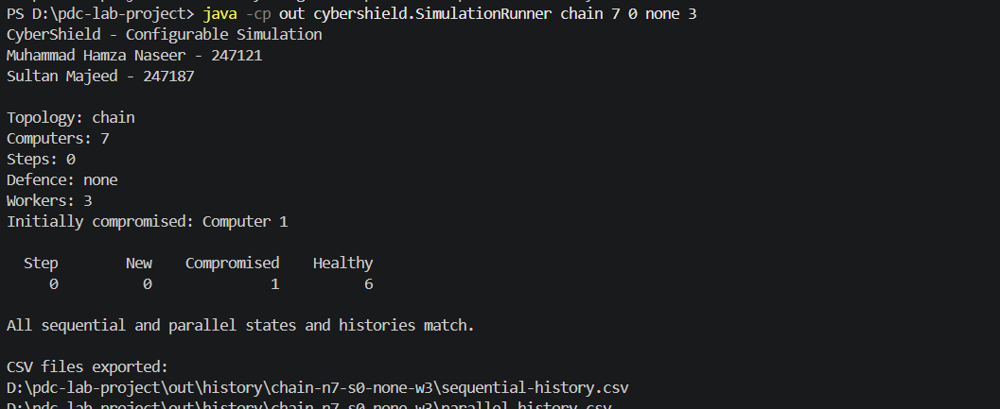

# Configurable Simulation Runner

## Project Members

- Muhammad Hamza Naseer — 247121
- Sultan Majeed — 247187

## Work Completed By

Muhammad Hamza Naseer — configurable Java execution, state comparison
and history export.

## Purpose

SimulationRunner allows simulation settings to be selected from the
command line without editing source code.

Each run executes separate sequential and data-parallel networks,
compares their states and histories, then exports both histories to CSV.

## Compile

From the project directory:

```powershell
javac -d out src\cybershield\*.java
```

## Command Format

```text
java -cp out cybershield.SimulationRunner <topology> <computers> <steps> <defence> <workers> [output-directory]
```

The first five arguments are required.
The output directory is optional.

Display help:

```powershell
java -cp out cybershield.SimulationRunner --help
```

## Arguments

| Argument | Accepted values |
|---|---|
| topology | chain, ring, star |
| computers | 3–1000 |
| steps | 0–1000 |
| defence | none, isolate, protect |
| workers | 1–min(computers, 32) |
| output-directory | Optional filesystem directory |

Topology and defence names are case-insensitive.

Invalid numeric input, out-of-range values, unknown options and
incorrect argument counts cause an error.

These bounds are practical limits for the current implementation.
They are not hardware limits.

## Scenario Rules

Computer 1 starts compromised in every run.

| Defence | Behaviour |
|---|---|
| none | No defensive flags applied |
| isolate | Isolate Computer 1 |
| protect | Protect Computer computers / 2 + 1 |

The protection target uses integer division.

In the star topology, Computer 1 is the central hub.

Protection blocks new compromise. Isolation blocks sending and receiving.
Neither operation cures an existing compromise.

## Execution and Verification

The runner creates separate networks for sequential and data-parallel
execution using identical settings.

Step 0 records initial states without executing propagation.

After each step, the runner compares:

- Individual computer IDs and state flags.
- Newly compromised counts.
- Total compromised counts.
- Healthy counts.

It also checks that history counts are within valid bounds and that
the increase in the total equals the new-compromise count.

A mismatch causes an AssertionError.

Matching the two implementations is a consistency check, not independent
proof that both are correct. Known scenario checks provide additional
verification elsewhere in the project.

## Example Runs

### Protected Chain

```powershell
java -cp out cybershield.SimulationRunner chain 7 6 protect 3
```

Expected final totals: 3 compromised, 4 healthy.

### Protected Ring

```powershell
java -cp out cybershield.SimulationRunner ring 7 6 protect 3
```

Expected final totals: 6 compromised, 1 healthy.

### Unprotected Star

```powershell
java -cp out cybershield.SimulationRunner star 7 1 none 2
```

Expected final totals: 7 compromised, 0 healthy.

### Zero Steps

```powershell
java -cp out cybershield.SimulationRunner chain 7 0 none 3
```

Expected final totals: 1 compromised, 6 healthy.
Only the initial history row is produced.

### Invalid Worker Count

```powershell
java -cp out cybershield.SimulationRunner chain 7 6 none 8
```

This must fail because the worker count exceeds the network size.

## Successful Output

The program prints configuration details and a history table.

After verification succeeds, it prints:

```text
All sequential and parallel states and histories match.
```

It then exports the CSV files and prints their paths.

A file-writing failure may occur after successful simulation verification.
Successful verification alone does not establish that export succeeded.

## CSV Output

Default directory format:

```text
out/history/<topology>-n<computers>-s<steps>-<defence>-w<workers>/
```

For example:

```text
out/history/ring-n7-s6-protect-w3/
```

Each directory contains:

```text
sequential-history.csv
parallel-history.csv
```

Columns:

```csv
step,newly_compromised,total_compromised,healthy
```

Each file contains one header and steps + 1 data rows.

Different configurations use different default directories.
Repeating the same configuration replaces its previous exports.

The default output is inside the ignored out directory.

## Custom Output Directory

```powershell
java -cp out cybershield.SimulationRunner ring 7 6 protect 3 "out/custom history"
```

Quote paths containing spaces.

Both filenames remain fixed. Reusing a custom directory replaces
its previous sequential and parallel history files, even if the
simulation configuration has changed.

## Connection to the Course

This combines parallel-program design, data parallelism, synchronization,
network topology and sequential/parallel correctness comparison.

CSV output supports later analysis of simulation behaviour.

## Limitations

- The initial compromised computer is fixed to Computer 1.
- Defence targets are selected by the scenario rules.
- The data-parallel simulator creates new worker threads for each step.
- Network connections use an adjacency matrix.
- The program prints every history row.
- CSV files do not embed configuration metadata.
- Exports are not written atomically as a pair.
- This runner does not measure performance or claim a speedup.
## Execution Screenshots


Figure 1: A seven-computer protected ring runs with three workers.
Sequential and parallel histories match, ending with six compromised
computers, and CSV export succeeds.



Figure 2: Zero steps preserves the initial state and produces only
the step-zero history entry.
