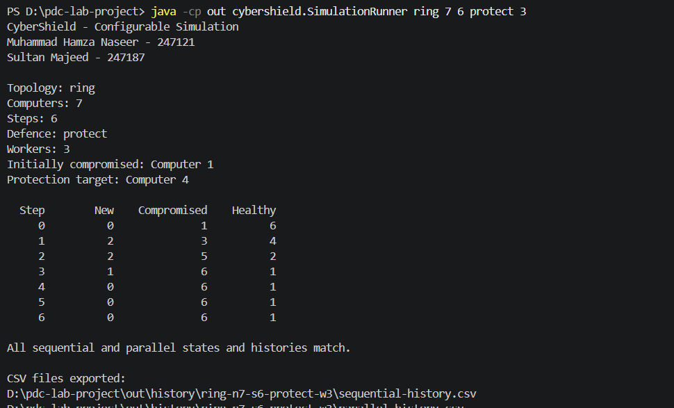
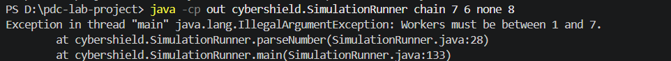
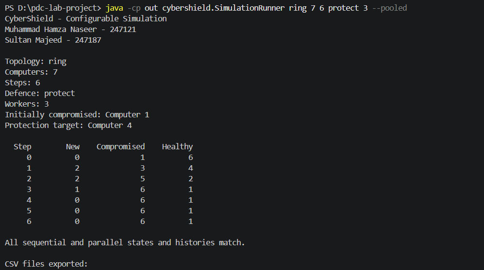
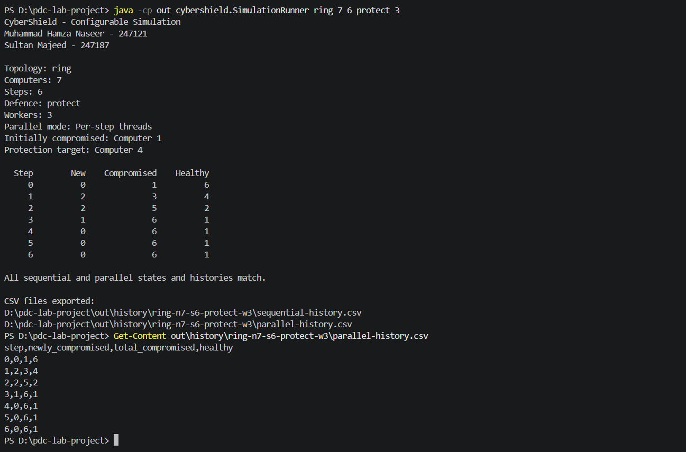
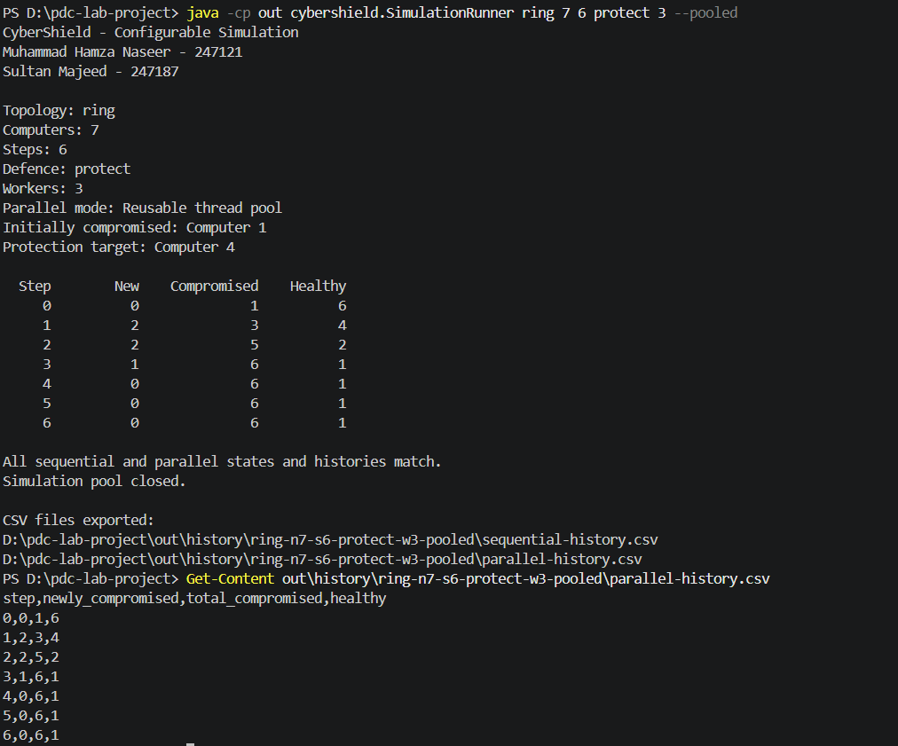

# Configurable Simulation Runner

## Project Members

- Muhammad Hamza Naseer — 247121
- Sultan Majeed — 247187

## Work Completed By

Muhammad Hamza Naseer — configurable Java execution, parallel-mode
selection, state comparison and CSV history export.

## Purpose

SimulationRunner accepts simulation settings from the command line.

Each run executes separate sequential and parallel networks,
compares their states and histories, and exports both histories.

Two parallel modes are available:

| Mode | Selection | Worker lifecycle |
|---|---|---|
| Per-step threads | Default | Creates new threads each step |
| Reusable thread pool | Add --pooled last | Reuses pool threads across steps |

Both modes process target ranges within one network.

## Compile

```powershell
javac -d out src\cybershield\*.java
```

## Command Format

```text
java -cp out cybershield.SimulationRunner <topology> <computers> <steps> <defence> <workers> [output-directory] [--pooled]
```

The first five arguments are required.

The output directory is optional.
If supplied, --pooled must be the final argument.

Display help:

```powershell
java -cp out cybershield.SimulationRunner --help
```

## Arguments

| Argument | Accepted values |
|---|---|
| topology | chain, ring, star |
| computers | 3–1000 |
| steps | 0–1000 |
| defence | none, isolate, protect |
| workers | 1–min(computers, 32) |
| output-directory | Optional filesystem directory |
| --pooled | Optional final flag selecting reusable workers |

Topology and defence names are case-insensitive.
The --pooled flag must use the spelling shown.

Unknown or misplaced double-dash options are rejected.

Invalid numbers, out-of-range values and incorrect argument counts
produce errors.

These bounds are practical application limits, not hardware limits.

## Scenario Rules

Computer 1 starts compromised in every run.

| Defence | Action |
|---|---|
| none | Apply no defence |
| isolate | Isolate Computer 1 |
| protect | Protect Computer computers / 2 + 1 |

The protection target uses integer division.

Computer 1 is the hub in the star topology.

Protection blocks new compromise. Isolation blocks sending and receiving.
Neither cures an existing compromise.

## Execution and Verification

The runner creates separate sequential and parallel networks with
identical settings.

Step 0 records the initial state without propagation.

At each recorded step, it compares:

- Computer IDs and individual state flags.
- Newly compromised counts.
- Total compromised counts.
- Healthy counts.

It also checks count bounds and verifies that each increase in total
compromises equals the new-compromise count.

A mismatch causes an AssertionError.

Matching implementations provide a consistency check. Separate known
scenario checks provide additional verification.

## Pooled Resource Lifecycle

Pooled mode uses try-with-resources.

The pool is closed after simulation, including when execution throws.
On successful completion, closure occurs before printing results and
exporting CSV files.

A zero-step pooled run also closes its executor. No propagation tasks
are submitted in that case.

Successful pooled execution reports:

```text
Simulation pool closed.
```

## Example Commands

### Default Per-Step Threads

```powershell
java -cp out cybershield.SimulationRunner ring 7 6 protect 3
```

### Reusable Workers

```powershell
java -cp out cybershield.SimulationRunner ring 7 6 protect 3 --pooled
```

Both ring commands should finish with six compromised computers
and one healthy computer.

### Zero Steps with Pooled Mode

```powershell
java -cp out cybershield.SimulationRunner chain 7 0 none 3 --pooled
```

Expected: one compromised computer, six healthy computers and only
the step-zero history entry.

### Custom Output Directory

```powershell
java -cp out cybershield.SimulationRunner ring 7 6 protect 3 "out/custom history" --pooled
```

Quote paths containing spaces.

### Invalid Worker Count

```powershell
java -cp out cybershield.SimulationRunner chain 7 6 none 8
```

This is rejected because eight workers exceed the seven-computer size.

## Successful Output

The program prints configuration details, selected parallel mode
and the history table.

Successful verification reports:

```text
All sequential and parallel states and histories match.
```

After exporting both files, their paths are printed.

A successful simulation check does not guarantee successful file export.
An export failure propagates as IOException.

## Default CSV Directories

Per-step mode preserves the existing directory format:

```text
out/history/<topology>-n<computers>-s<steps>-<defence>-w<workers>/
```

Pooled mode adds a suffix:

```text
out/history/<topology>-n<computers>-s<steps>-<defence>-w<workers>-pooled/
```

Both directories contain:

```text
sequential-history.csv
parallel-history.csv
```

Columns:

```csv
step,newly_compromised,total_compromised,healthy
```

Each file has one header and steps + 1 data rows.

Repeating a configuration replaces its existing files.

Default directories separate the two modes. An explicitly supplied
custom directory is used as given; reusing it overwrites its fixed
filenames regardless of execution mode.

## Compare Exported Modes

After running both protected-ring commands:

```powershell
$perStepHistory = Get-Content out\history\ring-n7-s6-protect-w3\parallel-history.csv -Raw
$pooledHistory = Get-Content out\history\ring-n7-s6-protect-w3-pooled\parallel-history.csv -Raw
$perStepHistory -eq $pooledHistory
```

Expected result:

```text
True
```

This compares exported aggregate histories. Individual computer states
are checked against the sequential baseline inside each execution.

## Earlier Execution Evidence



Figure 1: The original runner executes a protected ring and exports
matching histories.


Figure 2: The original runner preserves initial states with zero steps.



Figure 3: An invalid worker count is rejected.

These screenshots predate pooled-mode integration.

## Connection to the Course

The runner demonstrates parallel-program design, data parallelism,
synchronization, worker lifecycle management and correctness comparison.

## Limitations

- Computer 1 is always the initial compromised source.
- Defence targets follow fixed scenario rules.
- Connections use an adjacency matrix.
- Every history row is printed.
- CSV files do not embed configuration metadata.
- CSV exports are not atomic as a pair.
- This runner does not measure performance.
- Thread reuse has not yet demonstrated a measured speedup.

See [reusable worker implementation](pooled-data-parallel.md)
for pool behaviour and failure handling.
## Pooled Execution Evidence



Figure 4: Three reusable workers simulate the protected ring.
Sequential and pooled histories match, the pool closes, and CSV files
are exported to the pooled-mode directory.

## Per-Step Thread CSV Evidence



The protected-ring execution using per-step threads exports seven
history entries, covering steps 0–6. The final entry records six
compromised computers and one healthy computer.

## Pooled Worker CSV Evidence



The protected-ring execution using reusable workers exports seven
history entries, covering steps 0–6. The final entry records zero
new compromises, six compromised computers and one healthy computer.
