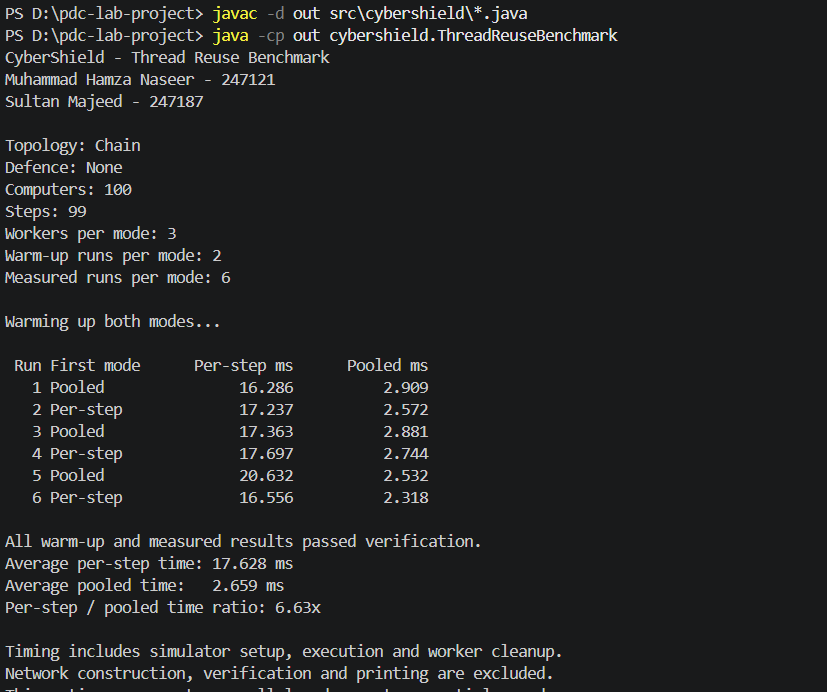

# Thread Reuse Benchmark

## Project Members

- Muhammad Hamza Naseer — 247121
- Sultan Majeed — 247187

## Work Completed By

Muhammad Hamza Naseer — benchmark implementation and execution.

## Purpose

Compare two within-network parallel implementations:

- DataParallelSimulator creates new threads each step.
- PooledDataParallelSimulator reuses threads across steps.

Both use the same target-oriented propagation approach and
disjoint target ranges.

## Configuration

| Setting | Value |
|---|---|
| Topology | Chain |
| Defence | None |
| Initially compromised | Computer 1 |
| Computers | 100 |
| Steps | 99 |
| Workers per mode | 3 |
| Warm-up runs per mode | 2 |
| Measured runs per mode | 6 |

## Method

Each run uses a fresh network with identical initial conditions.

Warm-up runs execute before measured runs.
The first execution mode alternates between measured rounds.

Measurements use System.nanoTime.

Included in timing:

- Simulator setup.
- Worker creation, including lazy pool-thread creation.
- All simulation steps.
- Per-step joins or pool task coordination.
- Worker cleanup and pool closure.

Excluded from timing:

- Network construction.
- Sequential reference execution.
- Result verification.
- Console printing.

Each pooled run creates and closes its own pool.
Threads are reused across steps within that run.

## Correctness Verification

Every warm-up and measured result is checked against:

- A sequential reference network.
- Expected final chain states.
- The expected accumulated new-compromise count.
- Expected isolation and protection flags.

For this configuration, all 100 computers must finish compromised,
with 99 new compromises accumulated across the simulation.

All warm-up and measured results passed verification.

## Recorded Measurements

| Run | First mode | Per-step threads (ms) | Pooled workers (ms) |
|---:|---|---:|---:|
| 1 | Pooled | 16.286 | 2.909 |
| 2 | Per-step | 17.237 | 2.572 |
| 3 | Pooled | 17.363 | 2.881 |
| 4 | Per-step | 17.697 | 2.744 |
| 5 | Pooled | 20.632 | 2.532 |
| 6 | Per-step | 16.556 | 2.318 |

The program reported:

| Metric | Result |
|---|---:|
| Mean per-step time | 17.628 ms |
| Mean pooled time | 2.659 ms |
| Per-step / pooled time ratio | 6.63x |
| Approximate elapsed-time reduction | 84.9% |

Reported means and ratios are calculated from internal nanosecond
measurements. Displayed run values are rounded.

## Interpretation

Pooled execution took less time in all six measured rounds.

The mean per-step execution time was approximately 6.63 times
the mean pooled execution time.

This result is consistent with reducing repeated thread-creation
overhead. The benchmark also includes differences in task submission,
coordination and cleanup, so it does not isolate thread creation alone.

The ratio compares two parallel modes.
It is not sequential-versus-parallel speedup and should not be used
to calculate parallel efficiency.

## Compile and Run

```powershell
javac -d out src\cybershield\*.java
```

After successful compilation:

```powershell
java -cp out cybershield.ThreadReuseBenchmark
```

Explicit configuration:

```powershell
java -cp out cybershield.ThreadReuseBenchmark 100 99 3
```

When arguments are supplied, all three are required:

```text
ThreadReuseBenchmark [computers steps workers]
```

Accepted ranges:

- Computers: 3–1000.
- Steps: 1–1000.
- Workers: 1–min(computers, 16).

## Limitations

- These measurements come from one benchmark session.
- Only one topology, defence scenario and configuration were measured here.
- Two warm-up runs do not guarantee complete JVM warm-up.
- Background activity, power settings and thermal conditions may affect results.
- No separate timing of thread creation or queue coordination was collected.
- The sequential reference is used for correctness, not timed comparison.
- Performance on larger networks or other worker counts may differ.

The exact execution environment and power/background conditions
were not captured in this result record. Earlier laptop benchmark
specifications must not automatically be attributed to these measurements.
## Execution Screenshot



Figure 1: For 100 computers, 99 steps and three workers, the recorded
mean times are 17.628 ms for per-step threads and 2.659 ms for pooled
workers. The time ratio is 6.63x, and all results pass verification.
